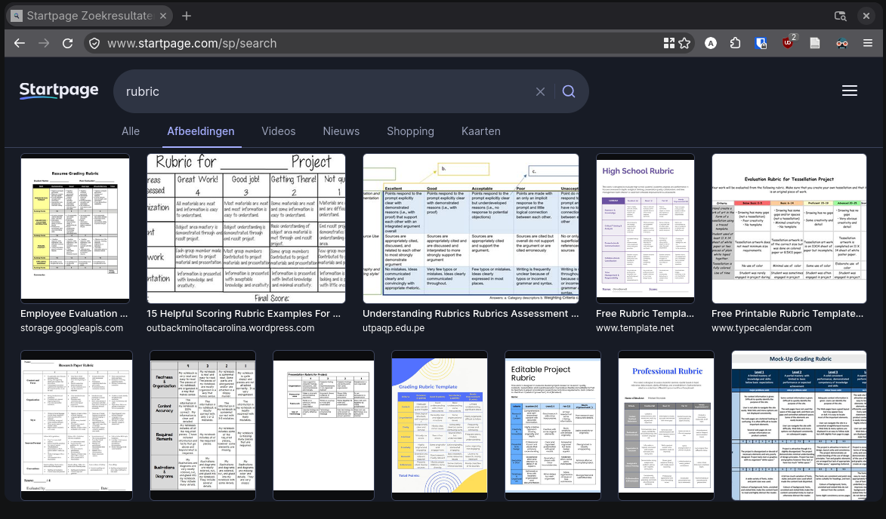
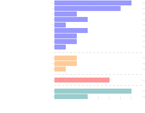

<!-- .slide: data-background-gradient="linear-gradient(to bottom right, #000, rgb(1, 79, 101))" -->

# How Computer Science Teachers Assess Open-ended Programming Assignments

<!-- .element: style="font-size: 1.4em" -->

Paper for Koli Calling '26\
Presented at the FMT Colloquium on 2026-10-22

**Arthur Rump**, Angelika Mader, Vadim Zaytsev\
University of Twente

Notes:
start schoolish: please all raise your hand

---

<!-- .slide: style="text-align: left" -->

Keep your hand raised, if...

<ul style="list-style-type: none">
<li class="fragment">you have heard the term <b>rubric</b> before
<li class="fragment">you think you know what the term means
<li class="fragment">you use them in your teaching
</ul>

Notes:
or raise your hand again if you use a rubric, but don't know what it is

please picture in your mind what a rubric looks like

&rarr; what do you see? is that what you use in your course?

---

---

<!-- .slide: class="full-height" style="text-align: left" -->

**rubric**

1. evaluative criteria
2. gradations of quality for each criterion
3. scoring strategy <!-- .element: style="opacity: .6" -->

Goodrich, Heidi. 1996. Understanding Rubrics. <https://www.ascd.org/el/articles/understanding-rubrics>\
Popham, W. James. 1997. What's Wrong—and What's Right—with Rubrics. <https://eric.ed.gov/?id=EJ552014>

Notes:
First two as defined by Heidi Goodrich, though she notes "the term defies a dictionary definition"; James Popham added the third one.

---

<table class="rubric">
<thead>
<tr>
    <th style="border-left: none !important; border-top: none !important;">
    <th>
    <th>levels
    <th>
    <th>
</thead>
<tbody>
<tr>
    <td>
    <td>
    <td>descriptors
    <td>
    <td>
<tr>
    <td>criteria
    <td>
    <td>
    <td>
    <td>
<tr>
    <td>
    <td>
    <td>
    <td>
    <td>
</tbody>
</table>

---

<!-- .slide: class="full-height" style="text-align: left" -->

**rubric**

any type of description or guideline used for grading or assessment

Dawson, Phillip. 2015. Assessment rubrics: towards clearer and more replicable design, research and practice. [10.1080/02602938.2015.1111294](https://doi.org/10.1080/02602938.2015.1111294)

***

How do\
computer science teachers\
assess\
open-ended programming assignments?

Notes:
working on tools to support feedback and assessment for open-ended programming assignments

probably using a rubric, what does it look like, what do they assess etc.

---

- **12** courses (by **11** teachers at **7** universities)
  - **11** BSc
    - **6** first year
      - **1** intro programming
    - **5** advanced
  - **1** MSc

<!-- .element: class="tree" -->

Notes:
interviews with 11 teachers from 7 universities about 12 **CS** courses

mostly BSc, but spread between first-year and more advanced, most expect some programming experience

---

**9** programming languages

C#

Haskell

Java

JavaScript

Python

Agda

C++

Erlang

Kotlin

or *student's choice*

Notes:
to sketch the diversity: languages these courses use

in 4 courses students can pick any language, brings us to openness

---

## how open-ended?

- **freedom** of
  - implementation
  - what to build
    - own ideas
    - client
    - bonus points

<!-- .element: class="fragment tree" -->

- **structure** through
  - technical requirements
  - starting template
  - incremental steps
  - process guidelines

<!-- .element: class="fragment tree" -->

&rarr; no single correct solution

<!-- .element: class="fragment" -->

Notes:
bonus points can be fully open or a choice from a given set

technical req: e.g. using a certain programming language or framework; meant to restrict the expected solution space, not eg a design choice that is assessed; not adhering to these requirements would be an invalid submission/desk reject

varied, but commonality: can't write one or a few correct model solutions to compare student's work with

---

**rubrics?**

**why open-ended?**

**what is assessed?**

Notes:
about one third in, let me tell you about the contents of this talk

continue the rubric discussion we started with, then ...

***

<!-- .slide: data-auto-animate data-auto-animate-id="rubrics" -->

## rubrics?

Notes:
Remember how I said at the start I had expected most people to have a rubric, in the table sense?

---

<!-- .slide: data-auto-animate data-auto-animate-id="rubrics" -->

## rubrics?

Notes:
also combinations of these

this is practice, if we go back to the literature on rubrics once more

---

<!-- .slide: class="full-height" -->

> A rubric used exclusively by a teacher to assign grades is a scoring rubric. A rubric that is cocreated with students; handed out; used to facilitate peer assessment, self-assessment, and teacher feedback; and only then used to assign grades is an instructional rubric. **It is not just about evaluation anymore; it is about teaching. Teaching with rubrics is where it gets good.**
> (Andrade, 2005)

Andrade, Heidi. 2005. Teaching With Rubrics: The Good, the Bad, and the Ugly. [10.3200/ctch.53.1.27-31](https://doi.org/10.3200/ctch.53.1.27-31)

---

### are rubrics shared with students?

5

3

2

shared

modified shared

not shared

---

<!-- .slide: style="text-align: left" -->

**shared with students**

> of course, the students are aware of the rubric. At least, it has been communicated with them,
> (08)

<!-- .element: style="font-size: .8em" -->

**students don't always look at it**

> but I think a very large proportion of the students do not really give it much thought,
> (08)

<!-- .element: style="font-size: .8em" -->

> Half of them cannot even find the rubric.
> (09)

<!-- .element: style="font-size: .8em" -->

---

<!-- .slide: style="text-align: left" -->

**modified version is shared**

> The project description explains what criteria are being used and explains based on what they are being assessed. And it leaves out the specific levels that these criteria are basically delineated in the rubric.
> (11)

<!-- .element: style="font-size: .8em" -->

**box ticking**

> [sharing the full rubric] will enable the box ticking behaviour without really promoting the positive aspect of engaging with the assignment, understanding what is being asked, what is necessary for it. [...] It will make it easier, but not necessarily as well done, as rich a work.
> (11)

<!-- .element: style="font-size: .8em" -->

Notes:
what i think is going on here: we look for indicators of quality to be able to perform quick assessments. if you give students the indicators, we enable Goodhart's law to play out (when the measure becomes a target)

---

<!-- .slide: style="text-align: left" -->

### experience with rubrics

**works well**

> in my experience, it is the case that in the end the average generally matches [the grade] you think the student should receive.
> (03)

<!-- .element: style="font-size: .8em" -->

**justification**

> most of the time it results in the grade we intuitively feel, but we see why and we can explain it too.
> (06)

<!-- .element: style="font-size: .8em" -->

Notes:
9 respondents said their rubric generally works well *for them*

they feel it also helps them with **consistency** (especially with multiple assessors)

even with a rubric, other research shows that consistency is low (though we also know not all rubrics are the same, so some may have better results than others in this regard)

---

<!-- .slide: style="text-align: left" -->

**over-specified**

> My opinion about rubrics is, like, it's okay, but at some point it's too much. [...] They're there to advise you and they're not really there to check boxes and you know, like, they should be treated that way.
> (02)

<!-- .element: style="font-size: .8em" -->

> you don't want to grow the rubric much bigger. [...] I know that it regularly happens that I think, well, that's not quite covered in there.
> (04)

<!-- .element: style="font-size: .8em" -->

**outcome does not match intuition**

> you often have that you think, 'oh, I would grant you a higher or lower grade based on what you show here.' But that can't be justified in the rubric.
> (04)

<!-- .element: style="font-size: .8em" -->

Notes:
this is a challenge right? it should be manageable, but also sufficiently complete, yet flexible

---

**rubrics?**

&rarr; maybe not one document?

Notes:
learning tool for students should maybe be less specific than the one used by a grader (with many specific examples for consistency)

design challenge: specifics, without overwhelming; keeping a shared base between student-facing and assessor-facing

***

<!-- .slide: data-auto-animate -->

## why open-ended?

---

<!-- .slide: data-auto-animate -->

**realistic**

> the goal is [to] prepare them for reality
> (06)

---

<!-- .slide: data-auto-animate -->

**learning experience**

> We give them two lectures on Scrum with the same content. The first Scrum-lecture we tell them how it all works. The second Scrum-lecture happens after the first sprint. And we give them the exact same information again, just expressed differently. And I often got the comment: 'Why didn't you tell us earlier?' I did, but now you know. So show, don't tell. That is everything here.
> (06)

---

<!-- .slide: data-auto-animate -->

**show genuine learning**

> the more you make it critical and open, the more you learn about genuinely [...] what the student learned.
> (02)

---

<!-- .slide: data-auto-animate -->

**guidance**

> I feel like it's a good strategy for a first year course, first study period, because imagine now if I did completely open, students would be completely lost, right?
> (02)

Notes:
overall, not too many surprises here, just good to reiterate

***

<!-- .slide: data-auto-animate data-auto-animate-id="content" -->

## what is assessed?

functionality

<!-- .element: class="fragment r-fit-text" -->

Notes:
can be specified functional requirements, sometimes even automated tests; or: "app functions more or less without errors" (04) where students specify what behaviour should be

---

<!-- .slide: data-auto-animate data-auto-animate-id="content" -->

## what is assessed?

- code quality
  > The software is reliable and maintainability-aspects are clearly applied.
  > (01)
  <!-- .element: style="font-size: .8em;" -->
  - code style
    > Clear naming, structure and error handling.
    > (04)
    <!-- .element: class="fragment" style="font-size: .8em;" -->
  - design patterns
    > not adhering to MVC (by having an association from model to gui)
    > (05)
    <!-- .element: class="fragment" style="font-size: .8em;" -->

<!-- .element: class="tree" style="max-width: 70%" -->

Notes:
assessed in 9/12

so far, not too many surprises

---

<!-- .slide: data-auto-animate data-auto-animate-id="content" -->

## what is assessed?

design

code constructions

testing

process

product vision

reflection

reporting

Notes:
goes much beyond code, e.g. process also depends on reporting and observations from teachers; similar to capstone projects

this is relevant for building tools &rarr; we can't just do code analysis

***

<!-- .slide: data-auto-animate data-auto-animate-id="conclusions" -->

## conclusions

rubrics are not always rubrics <!-- .element: class="fragment" -->

there's more than just code <!-- .element: class="fragment" -->

Notes:
1. for me: tools need to be flexible, potentially distinguish who can see what

   for someone who creates rubrics: consider your audience; multiple audiences
2. so a tool can't just focus on code

---

<!-- .slide: data-auto-animate data-auto-animate-id="conclusions" -->

## conclusions

rubrics are not always rubrics

there's more than just code

**More in the paper:** \
how rubrics are used\
general experience\
consistency, judgement and workload

&rarr; [arthurrump.com/koli2026](https://arthurrump.com/koli2026) <!-- .element: style="color: var(--r-main-color)" -->

