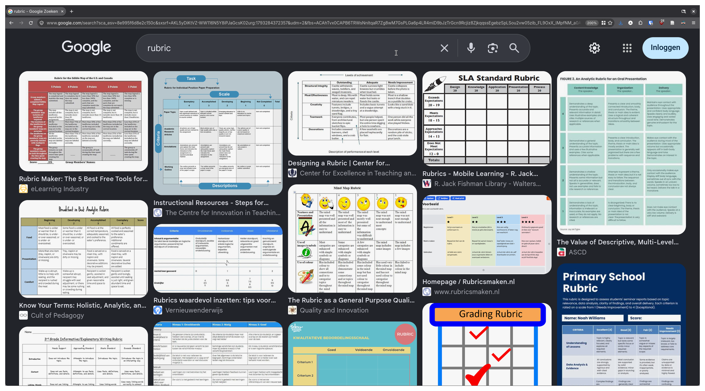
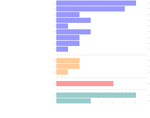

<!-- .slide: data-background-gradient="linear-gradient(to bottom right in oklab, #000, #014f65)" -->

# How Computer Science Teachers Assess Open-ended Programming Assignments

<!-- .element: style="font-size: 1.4em" -->

Koli Calling '26

**Arthur Rump**, Angelika Mader, Vadim Zaytsev\
University of Twente\
The Netherlands

Notes:

---

<!-- .slide: data-background-color="#014f65" -->

**PhD student** @ University of Twente\
**Informatics teacher** @ Quadraam

<!-- .element: style="text-align: right" -->

Tools for\
Feedback and Assessment in\
Learning Programming by Doing

<!-- .element: style="text-align: left; font-weight: bold; font-size: 1.6em" -->

Notes:
PhD student\
&rarr; project: tools; and for tools want current practice and tools (e.g. rubrics)\
&rarr; also a teacher

start schoolish &rarr; please all raise your hand

***

<!-- .slide: data-background-gradient="linear-gradient(to bottom right in oklab, #014f65, color-mix(in oklab, #014f65, #302B63 9.1%))"-->

<!-- .slide: style="text-align: left" -->

Keep your hand raised, if...

<ul style="list-style-type: none">
<li class="fragment">you have heard the term <b>rubric</b> before
<li class="fragment">you think you know what the term means
<li class="fragment">you use them in your teaching
</ul>

Notes:
or raise your hand again if you use a rubric, but don't know what it is

please picture in your mind what a rubric looks like

&rarr; what do you see? is that what you use in your course?

---

<!-- .slide: data-background-color="color-mix(in oklab, #014f65, #302B63 9.1%)" -->

---

<!-- .slide: class="full-height" style="text-align: left" data-background-color="color-mix(in oklab, #014f65, #302B63 18.2%)" -->

**rubric**

1. evaluative criteria
2. gradations of quality for each criterion
3. scoring strategy <!-- .element: style="opacity: .6" -->

Goodrich, Heidi. 1996. Understanding Rubrics. <https://www.ascd.org/el/articles/understanding-rubrics>\
Popham, W. James. 1997. What's Wrong—and What's Right—with Rubrics. <https://eric.ed.gov/?id=EJ552014>

Notes:
First two as defined by Heidi Goodrich, though she notes "the term defies a dictionary definition"; James Popham added the third one.

---

<!-- .slide: data-background-color="color-mix(in oklab, #014f65, #302B63 27.3%)" -->

<table class="rubric">
<thead>
<tr>
    <th style="border-left: none !important; border-top: none !important;">
    <th>
    <th>levels
    <th>
    <th>
</thead>
<tbody>
<tr>
    <td>
    <td>
    <td>descriptors
    <td>
    <td>
<tr>
    <td>criteria
    <td>
    <td>
    <td>
    <td>
<tr>
    <td>
    <td>
    <td>
    <td>
    <td>
</tbody>
</table>

***

<!-- .slide: data-background-gradient="linear-gradient(to bottom right in oklab, color-mix(in oklab, #014f65, #302B63 27.3%), color-mix(in oklab, #014f65, #302B63 36.4%))" -->

How do\
computer science teachers\
assess\
open-ended programming assignments?

<!-- .element: style="font-weight: bold; font-size: 1.4em" -->

Notes:
working on tools to support feedback and assessment for open-ended programming assignments

probably using a rubric, what does it look like, what do they assess etc.

---

<!-- .slide: data-background-color="color-mix(in oklab, #014f65, #302B63 36.4%)" -->

- **12** courses (by **11** teachers at **7** universities in 🇳🇱)
  - **11** BSc
    - **6** first year
      - **1** intro programming
    - **5** advanced
  - **1** MSc

<!-- .element: class="tree" style="margin-left: auto !important; margin-right: auto !important;" -->

Notes:
interviews with 11 teachers from 7 universities about 12 **CS** courses

mostly BSc, but spread between first-year and more advanced, most expect some programming experience

---

<!-- .slide: data-background-color="color-mix(in oklab, #014f65, #302B63 45.5%)" -->

**9** programming languages

C#

Haskell

Java

JavaScript

Python

Agda

C++

Erlang

Kotlin

or *student's choice*

Notes:
to sketch the diversity: languages these courses use

in 4 courses students can pick any language, brings us to openness

---

<!-- .slide: data-background-color="color-mix(in oklab, #014f65, #302B63 54.6%)" -->

## how open-ended?

- **freedom** of
  - implementation
  - what to build
    - own ideas
    - client
    - bonus points

<!-- .element: class="fragment tree" -->

- **structure** through
  - technical requirements
  - starting template
  - incremental steps
  - process guidelines

<!-- .element: class="fragment tree" -->

&rarr; no single correct solution

<!-- .element: class="fragment" -->

Notes:
bonus points can be fully open or a choice from a given set

technical req: e.g. using a certain programming language or framework; meant to restrict the expected solution space, not eg a design choice that is assessed; not adhering to these requirements would be an invalid submission/desk reject

varied, but commonality: can't write one or a few correct model solutions to compare student's work with &rarr; need to judge quality (rubric!?)

***

<!-- .slide: data-auto-animate data-auto-animate-id="rubrics" data-background-gradient="linear-gradient(to bottom right in oklab, color-mix(in oklab, #014f65, #302B63 54.6%), color-mix(in oklab, #014f65, #302B63 63.7%))" -->

## rubrics?

Notes:
Remember how I said at the start I had expected most people to have a rubric, in the table sense?

---

<!-- .slide: data-auto-animate data-auto-animate-id="rubrics" data-background-gradient="linear-gradient(to bottom right in oklab, color-mix(in oklab, #014f65, #302B63 54.6%), color-mix(in oklab, #014f65, #302B63 63.7%))" -->

## rubrics?

Notes:
also combinations of these

this is practice, if we go back to the literature on rubrics once more

---

<!-- .slide: class="full-height" data-background-color="color-mix(in oklab, #014f65, #302B63 63.7%)" -->

> Teaching with rubrics is where it gets good.
> (Andrade, 2005)

- **scoring rubric**
  - assigning grades

<!-- .element: class="tree" -->

- **instructional rubric**
  - co-created
  - handed out
  - peer assessment
  - self-assessment
  - teacher feedback

<!-- .element: class="tree" -->

Andrade, Heidi. 2005. Teaching With Rubrics: The Good, the Bad, and the Ugly. [10.3200/ctch.53.1.27-31](https://doi.org/10.3200/ctch.53.1.27-31)

---

<!-- .slide: data-background-color="color-mix(in oklab, #014f65, #302B63 72.8%)" -->

### are rubrics shared with students?

5

3

2

shared

modified shared

not shared

---

<!-- .slide: style="text-align: left" data-background-color="color-mix(in oklab, #014f65, #302B63 81.9%)" -->

**shared with students**

> Of course, the students are aware of the rubric. At least, it has been communicated with them,
> (08)

<!-- .element: style="font-size: .8em" -->

**students don't always look at it**

> but I think a very large proportion of the students do not really give it much thought.
> (08)

<!-- .element: style="font-size: .8em" -->

> Half of them cannot even find the rubric.
> (09)

<!-- .element: class="fragment" style="font-size: .8em" -->

Notes:
oh well, so far for the instructional rubric

---

<!-- .slide: style="text-align: left" data-background-color="color-mix(in oklab, #014f65, #302B63 91%)" -->

**modified version is shared**

> The project description explains what criteria are being used [...] and it leaves out the specific levels.
> (11)

<!-- .element: style="font-size: .8em" -->

**box ticking**

> [Sharing the full rubric] will enable the box ticking behaviour. [...] It will make it easier, but not necessarily as well done, as rich a work.
> (11)

<!-- .element: style="font-size: .8em" -->

Notes:
what i think is going on here: we look for indicators of quality to be able to perform quick assessments. if you give students the indicators, we enable Goodhart's law to play out

"When a measure becomes a target, it ceases to be a good measure."

challenge: clear indicators are helpful (possibly for consistency), but there are reasons not to share them with students

***

<!-- .slide: data-background-gradient="linear-gradient(to bottom right in oklab, color-mix(in oklab, #014f65, #302B63 91%), #302B63)" -->

## conclusions

rubrics are not always rubrics <!-- .element: class="fragment" -->

Notes:
first of all in structure

learning tool for students should maybe be less specific than the one used by a grader (with many specific examples for consistency)

design challenge: specifics, without overwhelming; keeping a shared base between student-facing and assessor-facing

---

<!-- .slide: style="text-align: left" data-background-gradient="linear-gradient(to bottom right in oklab, #302B63, #000)" -->

**Arthur Rump**\
[arthur.rump@utwente.nl](mailto:arthur.rump@utwente.nl) <!-- .element: style="color: var(--r-main-color)" -->

**More in the paper:** \
why open-ended?\
how rubrics are used\
formative vs summative\
what is assessed?\
general experience:\
consistency, judgement and workload

&rarr; [arthurrump.com/koli2026](https://arthurrump.com/koli2026) <!-- .element: style="color: var(--r-main-color)" -->

***

<!-- .slide: data-visibility="uncounted" -->

## why open-ended?

Notes:
- realistic: prepare students for the real world (can be a goal)
- learning experience: Scrum course, two lectures with the same content
- downside: very time intensive
- reasons for structure: help more junior students
